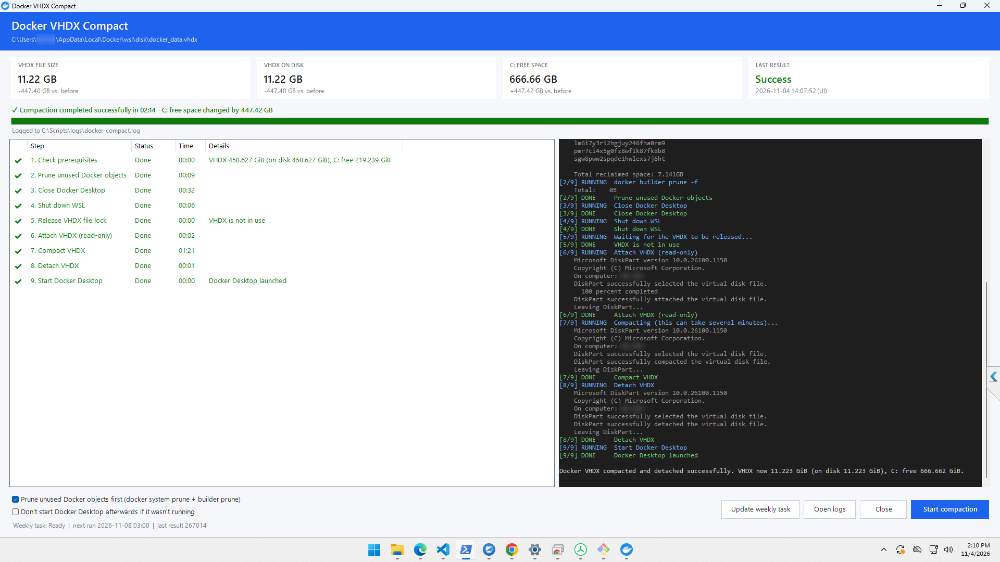
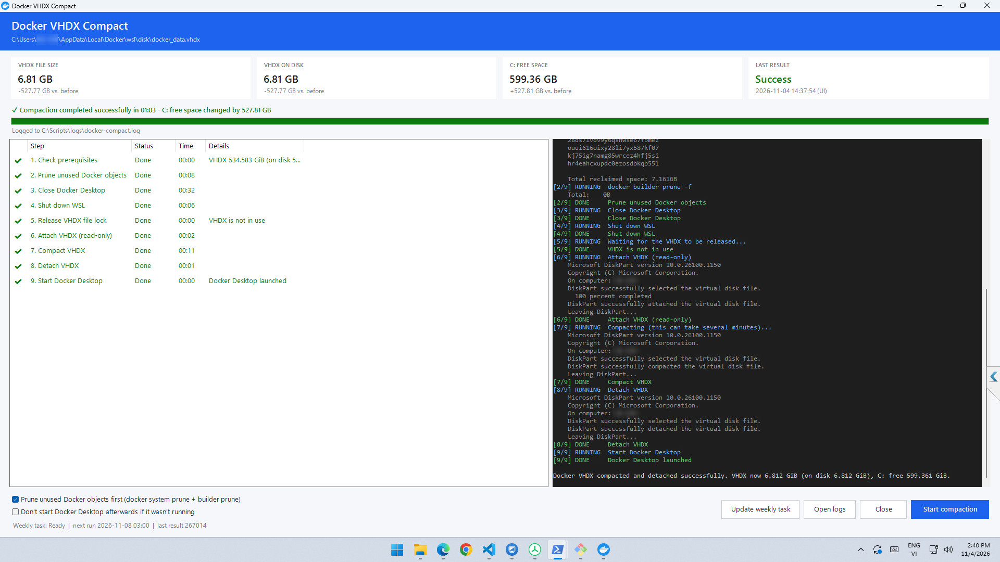

# Docker VHDX Compact (Windows + Docker Desktop)

**English** | [Tiếng Việt](docs/VIE.md)

Compacts Docker Desktop's WSL2 virtual disk (`docker_data.vhdx`) to give disk space back to Windows. It comes with:

- a **GUI** that shows every step live (pending / running / done / skipped / failed), overall and compaction progress, elapsed time, the live output, and before/after sizes;
- an **English / Vietnamese** interface (switch it in the top-right corner);
- a **VHDX picker** in case Docker's disk is not in the default location;
- a **scheduled task** (daily, weekly or monthly, at the time you choose) that does the same thing unattended;
- **TXT + CSV logs** for every run (GUI and task).

> **Important:** Compaction closes Docker Desktop and runs `wsl --shutdown`, so running containers and all WSL distros are stopped. Run it when that is safe.

## Screenshots

Real runs with **Prune** ticked:



*458.63 GB → 11.22 GB; 447.42 GB of free space gained on `C:`, in 2 min 14 s.*



*534.58 GB → 6.81 GB; 527.81 GB gained on `C:`, in 1 min 03 s.*

## Files

```text
C:\Scripts\
├── DockerCompact-UI.cmd          # double-click to open the GUI (portable use)
├── DockerCompact-UI.ps1          # the GUI (Windows Forms)
├── DockerCompact-Lang.json       # GUI text in English and Vietnamese
├── docker-compact.ps1            # the engine: does the actual compaction
├── DockerCompact-AutoSetup.ps1   # installs the weekly task / runs it with logging
├── DockerCompact-Common.ps1      # shared paths, snapshots and logging
├── launcher\DockerCompact.cs     # source of DockerCompact.exe (app icon + launcher)
├── installer\DockerCompact.iss   # Inno Setup script (Setup.exe)
├── build.ps1                     # builds DockerCompact.exe and Setup.exe
├── assets\images\                # app icon and screenshots
├── .github\workflows\release.yml # builds Setup.exe and publishes a Release
└── logs\                         # created automatically
    ├── docker-compact.log
    └── docker-compact-history-v2.csv
```

The scripts find each other through their own folder, so the whole set can live anywhere as long as the files stay together. The scheduled task points at wherever `DockerCompact-AutoSetup.ps1` was when you installed it.

## Install with the setup program

Download `DockerCompact-Setup-<version>.exe` from the repository's **Releases** page and run it (it asks for Administrator). It:

- installs the app to `C:\Program Files\DockerCompact`, which only administrators can change;
- adds Start Menu (and optionally desktop) shortcuts to `DockerCompact.exe`, which carries the app icon;
- optionally registers a weekly task (Sunday 03:00) for the user running the setup. Change it later with **Schedule...** in the app;
- writes logs to `C:\ProgramData\DockerCompact\logs`.

Silent install for many machines: `DockerCompact-Setup-1.0.0.exe /VERYSILENT /TASKS="weeklytask"`. Uninstalling removes the scheduled task and keeps the logs.

The weekly task runs as the account that registered it, and the VHDX lives in that user's `%LOCALAPPDATA%`. So on each machine, register the task as the person who uses Docker, from the setup program or with the app's **Schedule...** button.

### Building a release

`.github/workflows/release.yml` runs `build.ps1` on GitHub Actions:

```bash
git tag v1.0.0
```

```bash
git push nino v1.0.0
```

Pushing a `v*.*.*` tag checks the scripts' syntax and the UI strings, compiles `DockerCompact.exe` with the app icon, builds `dist\DockerCompact-Setup-1.0.0.exe` plus a `.sha256` file, and publishes both to a GitHub Release. Running the workflow by hand (**Actions → Build installer → Run workflow**) only produces a downloadable artifact.

To build locally, install [Inno Setup 6](https://jrsoftware.org/isdl.php) and run:

```powershell
powershell -NoProfile -ExecutionPolicy Bypass -File .\build.ps1 -Version 1.0.0
```

Without Inno Setup, `-SkipInstaller` builds only `dist\DockerCompact.exe`. The installer wizard itself is in English, because Inno Setup ships no official Vietnamese translation.

The installer is not code-signed, so SmartScreen shows "Windows protected your PC" (choose **More info → Run anyway**). Sign it with a code-signing certificate to remove the warning.

## Requirements

- Windows 10/11, Windows PowerShell 5.1.
- Docker Desktop with the WSL2 backend (per-user install in `%LOCALAPPDATA%\Programs\DockerDesktop` or machine-wide in `%ProgramFiles%\Docker\Docker`).
- The VHDX, by default `%LOCALAPPDATA%\Docker\wsl\disk\docker_data.vhdx`. Pick another location with **Change...** in the GUI.
- Administrator rights (DiskPart and `wsl --shutdown`). The GUI asks for them through UAC.
- English Windows display language: success is detected from DiskPart's English messages.

## Use the GUI

Open **Docker VHDX Compact** from the Start Menu (installed), double-click `DockerCompact-UI.cmd` (portable), or run:

```powershell
powershell -NoProfile -ExecutionPolicy Bypass -File "C:\Scripts\DockerCompact-UI.ps1"
```

1. Optional: tick **Prune unused Docker objects first** (`docker system prune -f` + `docker builder prune -f`).
2. Optional: also tick **Deep prune** to remove all unused images and all build cache (volumes are kept).
3. Optional: tick **Don't start Docker Desktop afterwards** to leave Docker stopped if it was not running before.
4. Click **Start compaction** and confirm.

The window lists the steps:

| # | Step | What happens |
|---|------|--------------|
| 1 | Check prerequisites | Administrator, VHDX and Docker Desktop present; records sizes |
| 2 | Prune unused Docker objects | Only when ticked; otherwise *Skipped* |
| 3 | Trim free space (fstrim) | `fstrim` on `/mnt/docker-desktop-disk` inside the `docker-desktop` distro, so freed space reaches the VHDX |
| 4 | Close Docker Desktop | Graceful close, then force-stops leftover Docker processes |
| 5 | Shut down WSL | `wsl --shutdown` |
| 6 | Release VHDX file lock | Waits until nothing holds the file; detaches a stale DiskPart attachment if needed |
| 7 | Attach VHDX (read-only) | DiskPart `attach vdisk readonly` |
| 8 | Compact VHDX | DiskPart `compact vdisk`, with live percentage |
| 9 | Detach VHDX | DiskPart `detach vdisk` |
| 10 | Start Docker Desktop | Relaunches Docker Desktop |

### Why the VHDX may not shrink

Docker Desktop mounts its data disk (ext4) **without** the `discard` option. When you delete images or build cache, Linux frees the space inside the filesystem but never tells the VHDX, so `compact vdisk` alone finds nothing to reclaim. Step 3 runs `fstrim` to release those blocks, and **it needs Docker Desktop to be running** when you start. If Docker is not running, the step shows a warning.

The VHDX can only shrink down to the data Docker still keeps. Preflight prints `docker system df` and the space used inside the disk, plus the most that can be reclaimed. If that number is small, free data first: tick **Deep prune** (`docker system prune -a` + `docker builder prune -a`: all unused images and all build cache; volumes are kept), or remove what you no longer need yourself.

If a step fails it is marked red with the reason, later steps show *Not run*, and the script still tries to detach the VHDX and restart Docker. The window cannot be closed while a run is in progress, so DiskPart is never interrupted halfway.

The cards at the top show the VHDX file size, the space it actually uses on disk, free space on `C:`, and the last recorded result. After a run they show the change compared with before.

- **Language** (top right): English or Tiếng Việt. The choice is remembered per user in `%APPDATA%\DockerCompact\settings.json`. Lines coming from the engine and DiskPart in the log stay in English.
- **Change...** next to the VHDX path picks another `docker_data.vhdx` (for example when Docker's disk image location was moved to another drive). **Use default** goes back to the default path. The free-space card follows the drive of the chosen VHDX.
- **Schedule...** sets up the scheduled task: daily (every N days), weekly (every N weeks, on chosen days) or monthly (a day of the month, or the last day), at the time you pick, optionally with prune. It shows a preview such as *every week on Sun at 03:00*, and **Remove schedule** deletes the task. The task uses the VHDX path selected in the app.
- **Open logs** opens the `logs` folder.

## Weekly scheduled task

From the GUI, click **Schedule...**, or from an Administrator PowerShell:

```powershell
Set-ExecutionPolicy -Scope Process Bypass -Force; & "C:\Scripts\DockerCompact-AutoSetup.ps1"
```

Without options this means every Sunday at 03:00. Other examples:

```powershell
& "C:\Scripts\DockerCompact-AutoSetup.ps1" -Schedule Daily -At 02:30
& "C:\Scripts\DockerCompact-AutoSetup.ps1" -Schedule Daily -Interval 3 -At 01:00
& "C:\Scripts\DockerCompact-AutoSetup.ps1" -Schedule Weekly -DaysOfWeek "Monday,Friday" -At 22:00
& "C:\Scripts\DockerCompact-AutoSetup.ps1" -Schedule Monthly -DayOfMonth Last -At 03:00
& "C:\Scripts\DockerCompact-AutoSetup.ps1" -Remove
```

More options: `-PruneBeforeCompact`, `-PruneAll` (with prune), `-VhdxPath "D:\Docker\disk\docker_data.vhdx"`. A monthly day that a month does not have (e.g. 31) is skipped that month.

The task runs as your account with highest privileges, using the Interactive logon type, so you need to be signed in. A missed run starts as soon as possible, and the task also runs on battery power.

```powershell
Get-ScheduledTaskInfo -TaskName "DockerCompact" | Format-List LastRunTime, LastTaskResult, NextRunTime
Start-ScheduledTask -TaskName "DockerCompact"      # run now (stops Docker!)
Disable-ScheduledTask -TaskName "DockerCompact"
Enable-ScheduledTask -TaskName "DockerCompact"
Unregister-ScheduledTask -TaskName "DockerCompact" -Confirm
```

## Command line

The engine can also be run directly from an Administrator PowerShell. It prints numbered steps:

```powershell
& "C:\Scripts\docker-compact.ps1"            # compact only
& "C:\Scripts\docker-compact.ps1" -Prune     # prune first
```

`-Prune -PruneAll` also removes all unused images and all build cache. `-VhdxPath` points at a VHDX outside the default location. `-KeepDockerStopped` leaves Docker Desktop stopped if it was not running. `-ProgressMarkers` adds the machine-readable `##STEP|id|state|message` and `##PCT|id|percent` lines that the GUI reads.

The script exits with code `0` only when compaction and detach were both confirmed, and `1` otherwise.

## Logs

- `logs\docker-compact.log`: every run's start/end, before/after snapshot, full script output and status.
- `logs\docker-compact-history-v2.csv`: one row per run with `Source` (UI/Task), `Status`, duration, VHDX file size, VHDX on-disk size, Get-VHD allocated/virtual size (when the Hyper-V module is installed), `C:` free space, and the deltas.

```powershell
Get-Content "C:\Scripts\logs\docker-compact.log" -Tail 80
Import-Csv "C:\Scripts\logs\docker-compact-history-v2.csv" | Format-Table StartTime, Source, Status, DurationSeconds, VhdxOnDiskBeforeGiB, VhdxOnDiskAfterGiB, CFreeDeltaGiB -AutoSize
```

## Notes

- `LastTaskResult = 0` only means the script exited with `0`; check the CSV for the space actually reclaimed.
- If the VHDX is not sparse, the file size and the on-disk size are the same. Compaction only reclaims space that the Linux filesystem inside has freed *and trimmed*, so pruning first and keeping Docker running when you start the compaction reclaims the most.
- The scripts never delete, reset, unregister or reformat the VHDX.

## License

[MIT](LICENSE)
