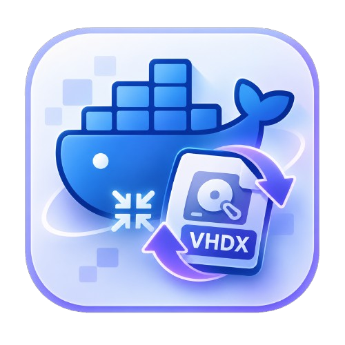
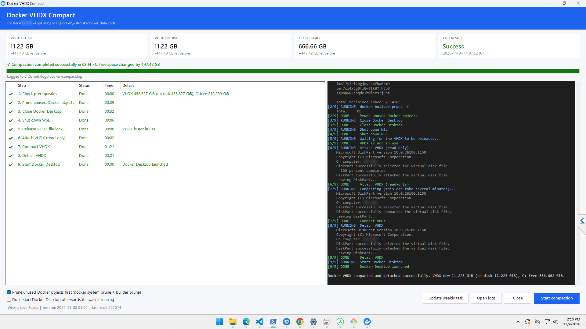
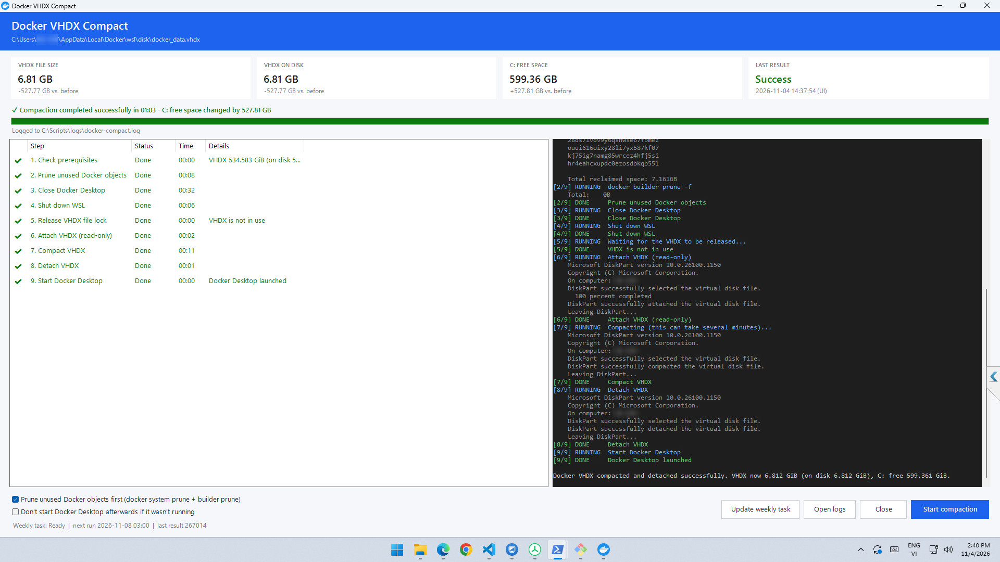

<p align="center">
  
</p>

<h1 align="center">Docker VHDX Compact</h1>

<p align="center">
  <b>Lấy lại dung lượng ổ cứng từ Docker Desktop trên Windows.</b><br>
  Trim và nén <code>docker_data.vhdx</code> của WSL2, có giao diện hiển thị trực tiếp từng bước.
</p>

<p align="center">
  <a href="https://github.com/TokisakiNinoVn/Docker-VHDX-Compact/releases/latest"></a>
  <a href="https://github.com/TokisakiNinoVn/Docker-VHDX-Compact/actions/workflows/release.yml"></a>
  <a href="https://github.com/TokisakiNinoVn/Docker-VHDX-Compact/releases"></a>
  <a href="../LICENSE"></a>
</p>

<p align="center">
  
  
  
  
  
  
</p>

<p align="center">
  <a href="https://github.com/TokisakiNinoVn/Docker-VHDX-Compact/releases/latest"><b>Tải về</b></a> ·
  <a href="#tính-năng">Tính năng</a> ·
  <a href="#cài-bằng-bộ-cài">Cài đặt</a> ·
  <a href="#dùng-giao-diện">Sử dụng</a> ·
  <a href="#công-nghệ">Công nghệ</a> ·
  <a href="../README.md">English</a>
</p>

## Tính năng

Ổ đĩa WSL2 của Docker Desktop (`docker_data.vhdx`) phình to dần khi bạn pull image và build, nhưng không bao giờ tự co lại, kể cả khi đã xoá dữ liệu. Công cụ này trả lại phần dung lượng đó cho Windows:

- **Giao diện trực quan**: từng bước hiển thị trạng thái chờ / đang chạy / xong / bỏ qua / lỗi, kèm tiến trình tổng và tiến trình nén, thời gian chạy, log trực tiếp và dung lượng trước/sau.
- **Thu nhỏ được thật**: chạy `fstrim` trong distro của Docker trước, để phần dung lượng Linux đã giải phóng về tới VHDX rồi DiskPart mới nén.
- **Prune tuỳ chọn**: `docker system prune` + `docker builder prune`, hoặc prune sâu toàn bộ image và build cache không dùng (giữ nguyên volume).
- **Giao diện tiếng Anh / tiếng Việt**, đổi ở góc trên bên phải.
- **Chọn đường dẫn VHDX** khi ổ đĩa của Docker không nằm ở vị trí mặc định.
- **Lịch tự động**: hằng ngày, hằng tuần hoặc hằng tháng, vào giờ bạn chọn, không cần thao tác.
- **Log TXT + CSV** cho mọi lần chạy (từ GUI lẫn tác vụ định kỳ).
- **Bộ cài** có shortcut trong Start Menu, được build và phát hành tự động bằng GitHub Actions.

> [!IMPORTANT]
> Quá trình nén sẽ đóng Docker Desktop và chạy `wsl --shutdown`, nên mọi container đang chạy và mọi distro WSL đều bị dừng. Chỉ chạy khi việc dừng này an toàn.

## Ảnh chụp

Kết quả chạy thật, có tick **Prune**:



*458,63 GB → 11,22 GB; ổ `C:` trống thêm 447,42 GB, mất 2 phút 14 giây.*



*534,58 GB → 6,81 GB; ổ `C:` trống thêm 527,81 GB, mất 1 phút 03 giây.*

## Các file

```text
C:\Scripts\
├── DockerCompact-UI.cmd          # double-click để mở giao diện (bản portable)
├── DockerCompact-UI.ps1          # giao diện (Windows Forms)
├── DockerCompact-Lang.json       # chữ trên giao diện, tiếng Anh và tiếng Việt
├── docker-compact.ps1            # engine: thực hiện việc nén
├── DockerCompact-AutoSetup.ps1   # cài tác vụ hàng tuần / chạy tác vụ kèm ghi log
├── DockerCompact-Common.ps1      # đường dẫn, đo dung lượng và ghi log dùng chung
├── launcher\DockerCompact.cs     # mã nguồn DockerCompact.exe (icon app + trình khởi chạy)
├── installer\DockerCompact.iss   # script Inno Setup (Setup.exe)
├── build.ps1                     # build DockerCompact.exe và Setup.exe
├── VERSION                       # số phiên bản, build.ps1 và workflow đọc từ đây
├── assets\images\                # icon app và ảnh chụp
├── .github\workflows\release.yml # build Setup.exe và đăng lên GitHub Release
└── logs\                         # tự tạo
    ├── docker-compact.log
    └── docker-compact-history-v2.csv
```

Các script tìm nhau theo thư mục chứa chúng, nên có thể đặt cả bộ ở bất kỳ đâu, miễn là các file nằm cùng nhau. Tác vụ định kỳ trỏ tới vị trí của `DockerCompact-AutoSetup.ps1` tại thời điểm cài.

## Cài bằng bộ cài

Tải `DockerCompact-Setup-<phiên bản>.exe` ở trang **Releases** của repo và chạy (bộ cài sẽ xin quyền Administrator). Bộ cài sẽ:

- cài app vào `C:\Program Files\DockerCompact`, thư mục chỉ admin mới sửa được;
- tạo shortcut ở Start Menu (tuỳ chọn thêm ngoài Desktop) trỏ tới `DockerCompact.exe`, file mang icon của app;
- tuỳ chọn đăng ký lịch hằng tuần (Chủ nhật 03:00) cho user đang chạy bộ cài. Đổi lịch sau bằng nút **Lên lịch...** trong app;
- ghi log vào `C:\ProgramData\DockerCompact\logs`.

Cài im lặng cho nhiều máy: `DockerCompact-Setup-1.0.0.exe /VERYSILENT /TASKS="weeklytask"`. Khi gỡ cài đặt, tác vụ định kỳ bị xoá nhưng log được giữ lại.

Tác vụ hàng tuần chạy dưới tài khoản đã đăng ký nó, và file VHDX nằm trong `%LOCALAPPDATA%` của user đó. Vì vậy trên mỗi máy, hãy đăng ký tác vụ bằng chính tài khoản dùng Docker, qua bộ cài hoặc nút **Lên lịch...** trong app.

### Build bản phát hành

Code được phát triển trên nhánh `dev`; nhánh `main` chỉ nhận các bản phát hành. `.github/workflows/release.yml` chạy `build.ps1` trên GitHub Actions **chỉ khi một pull request từ `dev` được merge vào `main`**:

1. Trên `dev`, ghi phiên bản mới vào file `VERSION` (ví dụ `1.1.1`), commit rồi push.
2. Mở pull request `dev` → `main` rồi merge.

Sau đó workflow kiểm tra cú pháp các script và file chữ giao diện, build `DockerCompact.exe` kèm icon app, build `dist\DockerCompact-Setup-<VERSION>.exe` cùng file `.sha256`, tạo tag `v<VERSION>` trên commit merge, rồi đăng cả hai file lên GitHub Release. Nếu tag đó đã có, build sẽ dừng để không ghi đè bản cũ: tăng `VERSION` rồi merge lại. Push lên nhánh nào, hay đóng pull request mà không merge, đều không build. Chạy workflow thủ công (**Actions → Build installer → Run workflow**) thì chỉ tạo artifact để tải về.

Build trên máy: cài [Inno Setup 6](https://jrsoftware.org/isdl.php) rồi chạy (phiên bản lấy từ `VERSION`; thêm `-Version 1.2.3` để ghi đè):

```powershell
powershell -NoProfile -ExecutionPolicy Bypass -File .\build.ps1
```

Nếu chưa có Inno Setup, thêm `-SkipInstaller` để chỉ build `dist\DockerCompact.exe`. Wizard của bộ cài là tiếng Anh vì Inno Setup không có bản dịch tiếng Việt chính thức.

Bộ cài chưa được ký số, nên SmartScreen sẽ hiện "Windows protected your PC" (chọn **More info → Run anyway**). Ký bằng certificate code-signing để hết cảnh báo này.

## Công nghệ

| Thành phần | Công nghệ |
|------------|-----------|
| Giao diện | Windows Forms trên Windows PowerShell 5.1 (không cần cài thêm runtime) |
| Engine nén | PowerShell + DiskPart (`attach vdisk readonly`, `compact vdisk`) |
| Giải phóng dung lượng trong ổ đĩa | `fstrim` trong distro WSL2 `docker-desktop`, `docker system` / `builder prune` |
| Launcher | C# `DockerCompact.exe`, biên dịch bằng `csc.exe` của .NET Framework; mang icon app và xin quyền UAC |
| Lập lịch | Windows Task Scheduler (task XML với trigger hằng ngày / hằng tuần / hằng tháng) |
| Đa ngôn ngữ | Bảng chuỗi JSON UTF-8 (tiếng Anh, tiếng Việt) |
| Bộ cài | Inno Setup 6 |
| CI/CD | GitHub Actions trên `windows-latest`: build và phát hành Release khi merge `dev` vào `main` |

## Yêu cầu

- Windows 10/11, Windows PowerShell 5.1.
- Docker Desktop dùng WSL2 backend (cài cho một user ở `%LOCALAPPDATA%\Programs\DockerDesktop` hoặc cho cả máy ở `%ProgramFiles%\Docker\Docker`).
- File VHDX, mặc định ở `%LOCALAPPDATA%\Docker\wsl\disk\docker_data.vhdx`. Nếu nằm chỗ khác thì chọn bằng nút **Đổi...** trong giao diện.
- Quyền Administrator (cho DiskPart và `wsl --shutdown`). Giao diện tự xin quyền qua UAC.
- Ngôn ngữ hiển thị của Windows là tiếng Anh: tool nhận biết thành công qua thông báo tiếng Anh của DiskPart.

## Dùng giao diện

Mở **Docker VHDX Compact** từ Start Menu (bản cài đặt), double-click `DockerCompact-UI.cmd` (bản portable), hoặc chạy:

```powershell
powershell -NoProfile -ExecutionPolicy Bypass -File "C:\Scripts\DockerCompact-UI.ps1"
```

1. Tuỳ chọn: tick **Prune unused Docker objects first** (`docker system prune -f` + `docker builder prune -f`).
2. Tuỳ chọn: tick thêm **Deep prune** để xoá cả mọi image không dùng và toàn bộ build cache (volume được giữ nguyên).
3. Tuỳ chọn: tick **Don't start Docker Desktop afterwards** để không bật lại Docker nếu trước đó nó không chạy.
4. Bấm **Start compaction** và xác nhận.

Các bước trong cửa sổ:

| # | Bước | Việc được làm |
|---|------|---------------|
| 1 | Check prerequisites | Kiểm tra quyền admin, file VHDX và Docker Desktop; ghi lại dung lượng |
| 2 | Prune unused Docker objects | Chỉ chạy khi được tick; nếu không thì *Skipped* |
| 3 | Trim free space (fstrim) | Chạy `fstrim` trên `/mnt/docker-desktop-disk` trong distro `docker-desktop` để vùng trống được trả về VHDX |
| 4 | Close Docker Desktop | Đóng bình thường, sau đó buộc dừng các tiến trình Docker còn sót |
| 5 | Shut down WSL | `wsl --shutdown` |
| 6 | Release VHDX file lock | Chờ tới khi không còn gì giữ file; detach attachment DiskPart cũ nếu cần |
| 7 | Attach VHDX (read-only) | DiskPart `attach vdisk readonly` |
| 8 | Compact VHDX | DiskPart `compact vdisk`, hiển thị phần trăm trực tiếp |
| 9 | Detach VHDX | DiskPart `detach vdisk` |
| 10 | Start Docker Desktop | Bật lại Docker Desktop |

### Vì sao VHDX có thể không nhỏ đi

Docker Desktop mount ổ dữ liệu (ext4) **không** có tuỳ chọn `discard`. Khi bạn xoá image hoặc build cache, Linux giải phóng chỗ bên trong ổ nhưng không báo cho file VHDX, nên chỉ chạy `compact vdisk` thì không có gì để thu hồi. Bước 3 chạy `fstrim` để giải phóng các block đó, và **bước này cần Docker Desktop đang chạy** lúc bạn bấm Start. Nếu Docker không chạy, bước này sẽ hiện cảnh báo.

VHDX chỉ có thể nhỏ lại tới mức dữ liệu Docker còn giữ. Bước kiểm tra đầu tiên in `docker system df`, dung lượng đang dùng thật bên trong ổ và mức tối đa có thể thu hồi. Nếu con số đó nhỏ, hãy giải phóng dữ liệu trước: tick **Deep prune** (`docker system prune -a` + `docker builder prune -a`: mọi image không dùng và toàn bộ build cache; volume được giữ nguyên), hoặc tự xoá những gì không còn cần.

Nếu một bước lỗi, bước đó được tô đỏ kèm lý do, các bước sau hiện *Not run*, và script vẫn cố detach VHDX rồi bật lại Docker. Không thể đóng cửa sổ khi đang chạy, nên DiskPart không bao giờ bị ngắt giữa chừng.

Các thẻ phía trên hiển thị kích thước file VHDX, dung lượng thật nó chiếm trên ổ, dung lượng trống của `C:` và kết quả lần chạy gần nhất. Sau mỗi lần chạy, thẻ hiển thị mức thay đổi so với trước.

- **Ngôn ngữ** (góc trên bên phải): English hoặc Tiếng Việt. Lựa chọn được nhớ theo từng user trong `%APPDATA%\DockerCompact\settings.json`. Các dòng log do engine và DiskPart in ra vẫn là tiếng Anh.
- **Đổi...** cạnh đường dẫn VHDX dùng để chọn file `docker_data.vhdx` khác (ví dụ khi đã chuyển disk image của Docker sang ổ khác). **Dùng mặc định** quay về đường dẫn mặc định. Thẻ dung lượng trống hiển thị theo ổ chứa VHDX đã chọn.
- **Lên lịch...** thiết lập lịch tự động: hằng ngày (mỗi N ngày), hằng tuần (mỗi N tuần, vào các ngày được chọn) hoặc hằng tháng (một ngày trong tháng, hoặc ngày cuối tháng), vào giờ bạn chọn, có thể kèm dọn dẹp. Dialog hiển thị trước lịch, ví dụ *hằng tuần vào CN lúc 03:00*. **Xoá lịch** xoá task. Lịch dùng đường dẫn VHDX đang chọn trong app.
- **Mở thư mục log** mở thư mục log.

## Tác vụ hàng tuần

Trong giao diện bấm **Lên lịch...**, hoặc chạy trong PowerShell quyền Administrator:

```powershell
Set-ExecutionPolicy -Scope Process Bypass -Force; & "C:\Scripts\DockerCompact-AutoSetup.ps1"
```

Không có tuỳ chọn nào nghĩa là Chủ nhật hằng tuần lúc 03:00. Các ví dụ khác:

```powershell
& "C:\Scripts\DockerCompact-AutoSetup.ps1" -Schedule Daily -At 02:30
& "C:\Scripts\DockerCompact-AutoSetup.ps1" -Schedule Daily -Interval 3 -At 01:00
& "C:\Scripts\DockerCompact-AutoSetup.ps1" -Schedule Weekly -DaysOfWeek "Monday,Friday" -At 22:00
& "C:\Scripts\DockerCompact-AutoSetup.ps1" -Schedule Monthly -DayOfMonth Last -At 03:00
& "C:\Scripts\DockerCompact-AutoSetup.ps1" -Remove
```

Tuỳ chọn khác: `-PruneBeforeCompact`, `-PruneAll` (đi kèm prune), `-VhdxPath "D:\Docker\disk\docker_data.vhdx"`. Ngày trong tháng mà tháng đó không có (ví dụ 31) thì tháng đó bỏ qua.

Tác vụ chạy dưới tài khoản của bạn với quyền cao nhất, kiểu đăng nhập Interactive, nên bạn cần đang đăng nhập. Lần chạy bị lỡ sẽ chạy bù sớm nhất có thể, và tác vụ vẫn chạy khi máy dùng pin.

```powershell
Get-ScheduledTaskInfo -TaskName "DockerCompact" | Format-List LastRunTime, LastTaskResult, NextRunTime
Start-ScheduledTask -TaskName "DockerCompact"      # chạy ngay (sẽ dừng Docker!)
Disable-ScheduledTask -TaskName "DockerCompact"
Enable-ScheduledTask -TaskName "DockerCompact"
Unregister-ScheduledTask -TaskName "DockerCompact" -Confirm
```

## Dòng lệnh

Có thể chạy trực tiếp engine trong PowerShell quyền Administrator. Engine in ra các bước có đánh số:

```powershell
& "C:\Scripts\docker-compact.ps1"            # chỉ nén
& "C:\Scripts\docker-compact.ps1" -Prune     # prune trước rồi nén
```

`-Prune -PruneAll` xoá thêm mọi image không dùng và toàn bộ build cache. `-VhdxPath` trỏ tới VHDX nằm ngoài vị trí mặc định. `-KeepDockerStopped` không bật lại Docker Desktop nếu trước đó nó không chạy. `-ProgressMarkers` in thêm các dòng `##STEP|id|state|message` và `##PCT|id|percent` mà giao diện đọc.

Script chỉ thoát với mã `0` khi xác nhận được cả bước nén lẫn bước detach, ngược lại thoát với mã `1`.

## Log

- `logs\docker-compact.log`: thời điểm bắt đầu/kết thúc, số đo trước/sau, toàn bộ output và trạng thái của mỗi lần chạy.
- `logs\docker-compact-history-v2.csv`: mỗi lần chạy một dòng, gồm `Source` (UI/Task), `Status`, thời gian chạy, kích thước file VHDX, dung lượng VHDX chiếm trên ổ, kích thước allocated/virtual theo Get-VHD (khi có module Hyper-V), dung lượng trống của `C:` và mức chênh lệch.

```powershell
Get-Content "C:\Scripts\logs\docker-compact.log" -Tail 80
Import-Csv "C:\Scripts\logs\docker-compact-history-v2.csv" | Format-Table StartTime, Source, Status, DurationSeconds, VhdxOnDiskBeforeGiB, VhdxOnDiskAfterGiB, CFreeDeltaGiB -AutoSize
```

## Ghi chú

- `LastTaskResult = 0` chỉ có nghĩa là script thoát với mã `0`; xem file CSV để biết dung lượng thật sự thu hồi được.
- Nếu VHDX không phải sparse thì kích thước file và dung lượng trên ổ bằng nhau. Việc nén chỉ thu hồi được vùng mà filesystem Linux bên trong đã giải phóng *và đã trim*, nên prune trước và để Docker đang chạy khi bắt đầu sẽ thu hồi được nhiều nhất.
- Các script không bao giờ xoá, reset, unregister hay format lại VHDX.

## Giấy phép

[MIT](../LICENSE)
